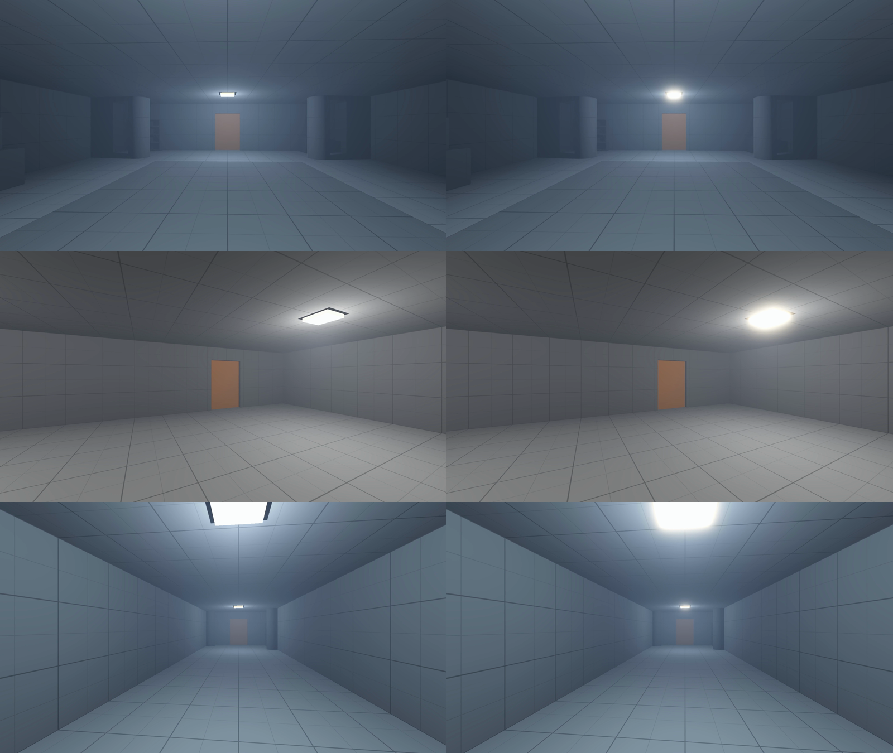

# Light and Atmosphere in Godot 4

Project files for tutorial 08 of the Godot 4 series by Phaix on YouTube (https://www.youtube.com/@Phaix).

Light the generated rooms of a game like Roblox DOORS in Godot 4.
We build an environment made for interiors, lamps that cast shadows, fog, glow and global illumination that works with rooms built while you play.

A building has no sky and no sun: the Environment gets a custom colour background, a cold trace of ambient light and the Filmic tonemap. A lamp becomes a scene of its own, placed from Marker3D nodes, with shadows on and the shadow atlas explained. Depth fog and volumetric fog give the air a body, glow makes the emissive fixture look bright, and SDFGI bounces the light in rooms that did not exist a second ago, with GI Mode Disabled for everything that moves. Every step is its own project folder.



## Steps

Every step of the video is its own folder in `steps/`, the exact state at the end of that
part. Open the project in Godot 4.7, then open `steps/<step>/main.tscn` and press F6 to run
that step. The project's main scene is the final step.

| Folder | Part of the video |
|---|---|
| `steps/step_00_start` | Starting point (the final state of tutorial 07) |
| `steps/step_01_environment` | Step 1 - An environment for rooms |
| `steps/step_02_lamps` | Step 2 - Lamps that cast shadows |
| `steps/step_03_fog` | Step 3 - Fog |
| `steps/step_04_glow` | Step 4 - Glow |
| `steps/step_05_global_illumination` | Step 5 - Global illumination |

## Controls

- W A S D or the arrow keys walk, and so does the left stick of a gamepad.
- The mouse or the right stick looks around.
- Space or the A button jumps.
- Esc gives the mouse back, and a left click captures it again.
- Hold Shift, or hold the left stick pressed in, to walk slowly.
- V or the left shoulder button shows your body from a second camera above the door, and V again gives the view back.
- Tab or the Back button shows and hides the map.
- R or the Y button starts the run again on the same seed.
- N or the right shoulder button starts a run on the next seed.
- T opens the seed box: type a seed and press Enter to start a run with it, or press Esc to close the box and change nothing. While the box is open, every other key you press goes into it.
- C or the X button copies the seed to the clipboard.
- F3 shows and hides the gizmos: the box of every planned room and its markers, drawn through the walls.
- F4 lifts the camera above the rooms to watch the generator, Enter plans the next room while you watch, and F4 again gives the view back.

## Tests

```sh
godot --headless --path . -s res://tests/run_tests.gd
```

## Support

Support the channel: https://ko-fi.com/phaix or https://github.com/sponsors/schemann

## License

Code and scenes: MIT (see LICENSE).
The figure and its animations: Animated Characters Protagonists by Kenney (www.kenney.nl), CC0, see character/License.txt.
